# Resumen

Se modela la lluvia diaria de 141 estaciones de la red CVC del Valle del Cauca (1981-2003) y el producto satelital pentadal de 0,05° como **curvas anuales** en una base B-spline construida a mano. El preprocesamiento se rehízo con las indicaciones de las asesorías del 19 y 20 de noviembre: inventario de % de faltantes por estación y año, comparación de las reglas OMM, NOAA y nacional (se eligió la nacional porque conserva 22 de las 28 estaciones del Pacífico, frente a 6 con la OMM), separación de la regla anual (≤25 % de faltantes) y la del periodo (>45 % de datos), prueba de que 0 mm nunca se trata como faltante, rachas de 30 días en cero contrastadas con dos vecinas a ≤25 km, altitud faltante tomada del SRTM 90 m y validada, y comparación de tres métodos de imputación (IDW, ponderación por correlación CSW y kriging ordinario) tras discriminar por altura (|Δz| ≤ 400 m) y radio (20 km). La comparación funcional muestra que el satélite sobreestima en abril-junio y subestima en enero-marzo, con un sesgo mediano del total anual de +10,4 %. En la fase 4, con la partición 1981-1996 (validación cruzada temporal) / 1997-2003 (prueba en tramos Niño, Niña y neutro), las tres cabezas reducen el sesgo del total anual (de +17,3 % a +4,6 % con la lineal), pero la ganancia en error L² relativo es pequeña: la MLP baja de 0,461 a 0,431 (IC bootstrap 95 % de la diferencia por estación [−0,057; −0,000]; Wilcoxon p = 0,30). La KAN es la mejor en el tramo Niño y la peor en el tramo Niña, donde amplifica el segundo pico. Ninguna cifra de este informe se escribió a mano: todas salen de tablas generadas por `proyecto_final.py` / `proyecto_final.R`, con log guardado.

# 1. Datos y preprocesamiento (fase 0)

## 1.1 Fuentes, resolución y unidades

Las estaciones traen lluvia **diaria puntual** en mm (no acumulada). Se trabaja en un dominio anual común [0, 365] días (el 29 de febrero se descarta). Se eligió la resolución diaria porque pasar a semanas o meses suaviza justo la variabilidad que interesa modelar, y porque las reglas de faltantes dependen del denominador: con datos diarios se cuentan 365 días; con péntadas serían 72 y "5 seguidos" equivaldría a 25 días. Por eso las reglas se aplican sobre el dato diario, antes de agregar nada.

El satélite son GeoTIFF de enteros en una malla de 39 × 37 píxeles de 0,05° (1981-2012 completos). En clase se dijo que el valor pentadal de CHIRPS es un promedio. Lo verificamos con los datos: en 208 910 péntadas con la estación completa, la media del satélite (25,4 mm) coincide con la **suma** de la estación en esa péntada (24,4 mm; razón 1,04) y no con su promedio diario (4,8 mm; razón 5,3) [Tab06i]. La cabecera oficial del netCDF de CHIRPS dice `units = "mm/pentad"` y `missing_value = -9999` (Funk et al., 2015; CHC-UCSB). El recorte entregado no tiene valores −9999, pero sí un **tope en 200 mm/péntada** (0,24 % de los valores son exactamente 200), que censura las péntadas más lluviosas del Pacífico. Cada péntada se divide entre su número de días para llevarla a mm/día. El ONI se tomó de NOAA-CPC; la fase ENSO de cada año es la media de sus 12 trimestres (≥ +0,5 Niño, ≤ −0,5 Niña).

## 1.2 Inventario de estaciones idóneas y elección de la regla

De 323 estaciones con datos en 1981-2003, solo 178 tienen coordenadas CVC dentro de la malla satelital (28 del Pacífico y 150 de la cuenca del Cauca). Sin coordenadas no se puede imputar espacialmente, emparejar con el satélite ni asignar altitud, así que el universo de trabajo son esas 178. El inventario es la tabla de **% de días faltantes por estación y por año** (`Tab06_faltantes_pct_estacion_anio.csv`, Fig. 1); el cero cuenta como dato.

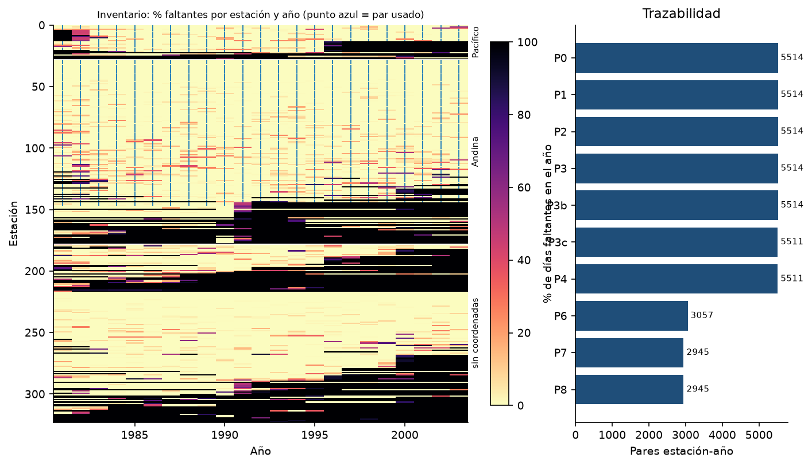{width=92%}

Se separan dos preguntas que en clase se mezclaban (Tabla 1): la **regla anual** (¿este año de esta estación sirve?) y la **regla del periodo** (¿la estación sirve?).

| Regla | Regla anual | Regla del periodo | Estaciones | Pacífico | Andina | Pares estación-año |
|---|---|---|---|---|---|---|
| OMM (como se citó en clase) | ≤10 faltantes y ≤5 seguidos | ≥80 % de años válidos | 77 | 6 | 71 | 1634 |
| NOAA | igual que OMM | ≥10 años válidos | 141 | 20 | 121 | 2605 |
| **Nacional (elegida)** | **≤25 % de faltantes** | **>45 % de datos** | **141** | **22** | **119** | **2945** |

: **Tabla 1.** Estaciones con coordenadas que retiene cada regla [Tab06c]. Universo: 178 (28 Pacífico, 150 Andina).

Elegimos la regla nacional por tres razones: (i) la OMM deja 6 de 28 estaciones del Pacífico y concentra el análisis en la zona andina, de modo que el modelo dejaría de ser "del Valle del Cauca" (lo mismo señaló el profesor el 20-nov); (ii) la regla de 10 días por año equivale a exigir 97,3 % de datos, cuando un año con 10 % de faltantes y vecinas con dato se puede imputar; (iii) por encima de ~25 % de faltantes en un año ya no se rescata la serie, así que ese es el umbral anual y los años que lo superan se descartan sin imputar. Dos precisiones honestas: la OMM aplica la regla de "11 o más días o 5 o más consecutivos" **por mes**, no por año (WMO, 2017, §4.4.1), y NOAA exige al menos 10 años para cualquier normal (NOAA NCEI, 2021). Además, **no encontramos la fuente publicada** del criterio "nacional >45 %" que se citó en clase; lo sustentamos con el umbral anual del profesor y con umbrales colombianos verificados: 15 % de faltantes por mes calendario (Martínez y Serna, 2018, IDEAM), mes válido con ≥80 % de días (IDEAM, 2020) y estaciones con <20 % de faltantes (Cruz-Roa y Barrios, 2018). Como referencia de preprocesamiento en la región, Russi y Larrahondo (2017) trabajaron con 97 de ~106 estaciones diarias IDEAM/CVC del Valle (1993-2011), y Gómez et al. (2024) eligieron una estación por municipio con CHIRPS diario; ninguno publica un umbral en %. Las estaciones elegidas del Pacífico tienen en mediana 89 % de datos, frente a 98 % en la zona andina: **el Pacífico lleva más imputación**, y así se declara.

## 1.3 Control de calidad, cero ≠ faltante y rachas secas

Los pasos P1-P3c no cambiaron respecto a la versión del 19-nov: valores imposibles (1), totales mensuales registrados en un solo día (331 valores), errores de digitación (5), meses con escala errónea (29) y bloques de 10 días copiados (2144) [Tab02]. Todos los umbrales se calibraron con años ≤ 1995, dentro del entrenamiento.

**Cero ≠ faltante.** Ningún paso convierte un 0 mm en NaN por ser cero. El código lo comprueba con un `assert`: todo cero del crudo que terminó en NaN debe tener una bandera de control de calidad. Resultado: de 1 126 184 ceros se conservan 1 123 213; los 2971 restantes vienen de rachas declaradas falla (2034), bloques copiados (649) y meses de "total en un día" (288), y **0 sin regla** [Tab02c]. Se conservan rachas secas largas: la mayor es de **96 días** (estación 2613000102, año Niño 1982), y 49 estaciones conservan alguna racha de 60 días o más.

**Rachas de 30 días en cero.** Las 889 rachas de ≥30 días se comparan con las 2 estaciones más cercanas a ≤25 km que tengan dato en ≥80 % de esos días. Si las vecinas llovieron (media ≥1 mm/día y ≥20 % de días con >1 mm), la racha es falla del sensor: pasa a NaN y se imputa. Si no, es sequía real y se conserva. Además se registran las "alzas" (≥10 mm en los 5 días previos y en los 5 posteriores). Resultado: 49 fallas (20 con alzas a ambos lados) y 840 sequías reales [Tab05; Fig. 2].

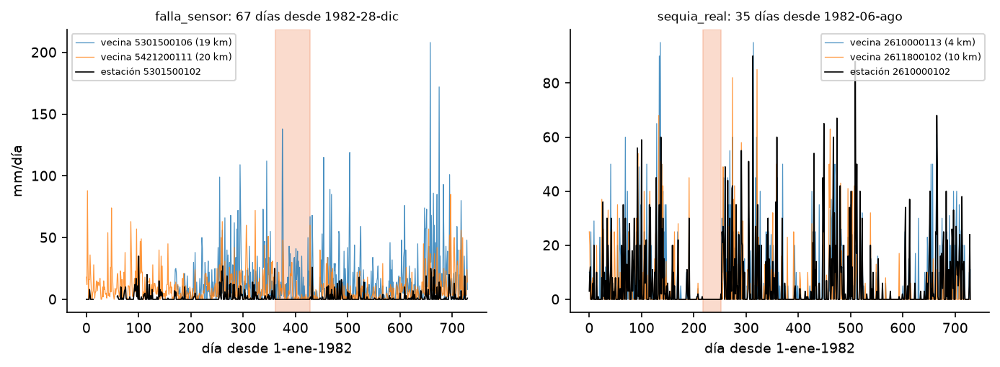{width=88%}

## 1.4 Altitud, relación lluvia-altura e imputación

**Altitud.** 87 estaciones con coordenadas no traen altitud. Se tomó del SRTM 90 m (OpenTopoData, conjunto `srtm90m`). Validación con las 126 estaciones que tienen las dos: sesgo +54 m, mediana del error absoluto 36,5 m, RMSE 276 m, r = 0,93, 70,6 % dentro de ±100 m, error máximo 1660 m [Tab06d]. El RMSE lo dominan unas pocas estaciones; la causa (coordenada imprecisa en ladera o error del catálogo) no se pudo verificar. El error de diseño del SRTM es <16 m (Farr et al., 2007), así que el error observado viene sobre todo de la georreferenciación.

**Lluvia-altura.** La relación **no es lineal** (Fig. 3, der.): el término cuadrático es significativo (R² lineal 0,06 frente a 0,24; p = 4·10⁻⁸). En el Pacífico la lluvia baja con la altura (−210 mm por cada 100 m; R² cuadrático 0,75); en la zona andina sube débilmente (Spearman 0,35) [Tab06e]. La correlación diaria entre estaciones a igual distancia también baja con la diferencia de altura: entre 0 y 10 km, r = 0,46 con |Δz| ≤ 400 m y r = 0,37 con |Δz| > 900 m [Tab06f]. Por eso la altura se discrimina antes que la distancia.

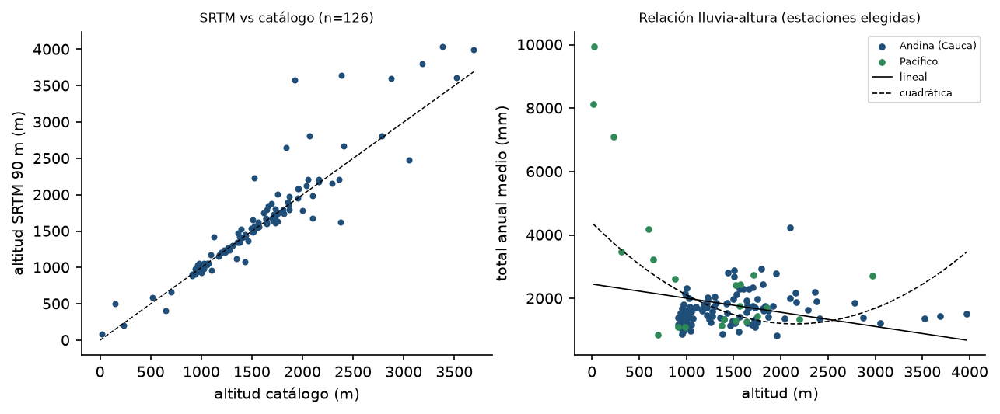{width=80%}

**Imputación.** Para cada día faltante se buscan donantes en dos pasos: primero la distancia en el eje vertical (|Δz| ≤ 400 m, la diferencia que el profesor consideró tolerable) y luego la distancia radial horizontal (≤ 20 km, el mayor radio en que la correlación diaria media de pares con |Δz| ≤ 400 m sigue en ≥ 0,30). Los donantes deben tener dato **ese mismo día**, para que las temporadas secas y lluviosas sean concurrentes (máximo 6). Se comparan tres métodos:

- **IDW**: peso 1/d² (Shepard, 1968). Solo usa la distancia; la discriminación la aporta la banda de altura.
- **CSW**: peso r², donde r es la correlación diaria 1981-1996 con la estación objetivo. Pondera por la similitud medida, que ya incorpora la altitud (Teegavarapu y Chandramouli, 2005).
- **Kriging ordinario**: covarianza exponencial r(h) = 0,345·e^(−h/201,5 km), con pepita 0,655 ajustada a las correlaciones de entrenamiento. No duplica el peso de estaciones agrupadas y usa un radio de búsqueda doble (40 km), dentro de la misma banda de altura (Goovaerts, 2000).

La validación fue dejar-uno-fuera sobre los 729 282 días observados de 1981-1996: cada día se predice con los donantes de ese día, sin usar la propia estación [Tab06g; Fig. 4].

| Método | RMSE diario (mm) | r diaria | RMSE total 30 días (mm) | Sesgo total 30 días | Días con donantes |
|---|---|---|---|---|---|
| IDW | 9,45 | 0,532 | 69,2 | +1,3 % | 89,3 % |
| **CSW** | 9,12 | 0,547 | **67,2** | **+0,1 %** | 89,3 % |
| Kriging ordinario | **8,94** | **0,549** | 69,7 | −2,3 % | 98,0 % |

: **Tabla 2.** Validación de la imputación (1981-1996).

El kriging gana a escala diaria y el CSW en el total de 30 días, que es la escala que conserva una curva con K = 6 bases. Elegimos **CSW** como método principal y **kriging con espacio de búsqueda mayor** como respaldo donde no hay donantes a 20 km. Las diferencias son pequeñas, como también encontraron Russi y Larrahondo (2017) en el Valle: ningún método domina en todos los escenarios. Se imputó el 1,13 % de los días de los pares elegidos en la zona andina y el 1,23 % en el Pacífico; quedaron 105 días sin donantes, que la fase 1 omite [Tab06h].

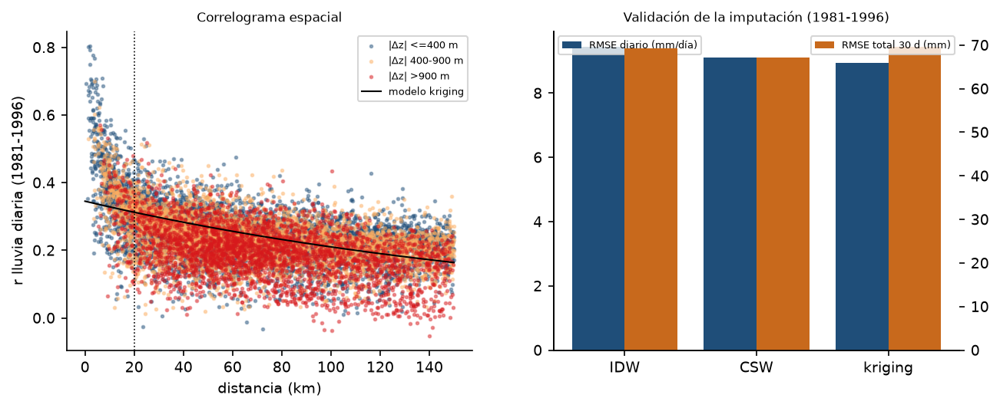{width=80%}

Al final del preprocesamiento quedan **141 estaciones y 2945 curvas estación-año** (Tabla 3).

| Paso | Estaciones | Pares | Días válidos |
|---|---|---|---|
| P0 crudo 1981-2003 | 323 | 5514 | 1 929 453 |
| P1-P3c control de calidad | 323 | 5511 | 1 926 943 |
| P4 rachas ≥30 ceros (falla) | 323 | 5511 | 1 924 909 |
| P6 regla del periodo (>45 %, con coordenadas) | 141 | 3057 | 1 082 653 |
| P7 regla anual (≤25 % faltantes) | 141 | 2945 | 1 062 509 |
| P8 imputación CSW + kriging | 141 | 2945 | 1 074 820 |

: **Tabla 3.** Trazabilidad [Tab02]. El script de R reproduce P0-P3c y la regla elegida a partir del inventario (`TabR06`).

# 2. Construcción de los datos funcionales (fase 1)

Cada curva x_i(t) = Σ_k c_ik φ_k(t) usa una base B-spline cúbica (Cox-de Boor) programada a mano. Los coeficientes ĉ = (Φ'Φ)⁻¹Φ'y salen de las ecuaciones normales con una factorización de Cholesky propia, sin librerías (numpy solo multiplica matrices). Con faltantes residuales, la curva se ajusta solo con los días observados. K se eligió con ECM, validación cruzada dejar-uno-fuera y VCG para cada fuente: **K = 6 para estaciones** (VCG = 108,56) y **K = 11 para el satélite** (VCG = 16,37); VC y VCG coinciden [Tab09]. La matriz de suavizado cumple tr(S) = K, idempotencia y simetría con error < 4·10⁻¹⁶ [Tab10], y la integral de la curva conserva el total anual (error relativo medio −0,0003 %) [Tab11]. Las bandas punto a punto ±2·EE tienen un EE medio de 1,19 mm/día para estaciones [Tab12]. R reproduce K y los coeficientes con `fda::smooth.basis`.

# 3. Análisis exploratorio funcional (fase 2)

La media funcional calculada a mano coincide con la de la librería (diferencia máxima 1,8·10⁻¹⁵) [Tab13]. El régimen es **bimodal**: según las derivadas, la primera temporada lluviosa empieza hacia el 28 de febrero, tiene su pico el 22 de abril y termina hacia el 17 de junio; la segunda empieza el 30 de septiembre y tiene su pico el 12 de noviembre (7,6 mm/día, el máximo del año). El mínimo es el 10 de agosto (2,6 mm/día) [Tab16]. La desviación estándar es máxima en enero (5,1 mm/día): el inicio del año es la época más variable entre años, por el ENSO. La anomalía del total anual se correlaciona con el ONI (Spearman −0,55, 23 años): con El Niño llueve menos [Tab21]. Las profundidades de Fraiman-Muniz y MBD (verificadas contra fuerza bruta y scikit-fda) y el boxplot funcional detectan 55 curvas atípicas en bruto y 21 en anomalía, repartidas en todas las fases ENSO (0,5-1,0 %) [Tab18-19].

**FPCA por régimen.** El profesor advirtió que mezclar Niño, Niña y neutro sesga los valores y vectores propios. Lo comprobamos con un FPCA por régimen en 1981-1996: ψ₁ (nivel medio, ~75 % de la varianza) es casi idéntica en los tres regímenes (|coseno| con la global ≥ 0,996), pero ψ₂ y ψ₃ cambian (|coseno| de 0,57 y 0,08 en La Niña) [Tab23b; Fig. 5]. Los modos secundarios, los que mueven la forma bimodal, dependen del régimen. En la fase 4 el decodificador usa el FPCA del régimen del año.

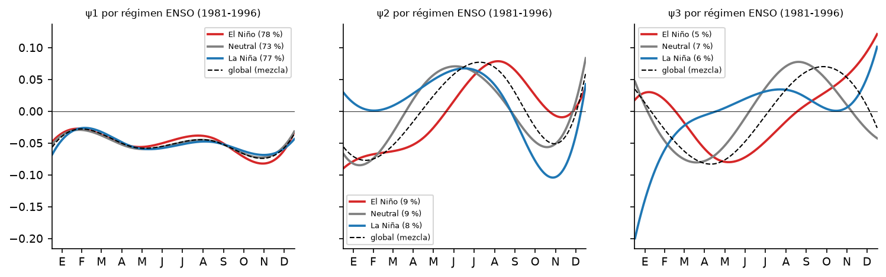{width=88%}

# 4. Comparación funcional por fuente (fase 3)

**Emparejamiento.** Cada estación se asigna al píxel que la contiene según sus coordenadas CVC (141 estaciones → 123 píxeles; los píxeles compartidos están en `Tab25`). Ambas fuentes se comparan con la misma K = 6, porque comparar K = 6 con K = 11 crea diferencias falsas por la resolución [Tab26b].

**Curva de diferencia.** d(t) = estación − satélite, con banda d̄(t) ± 2·EE y la estación como unidad. La estación supera al satélite del 3 de enero al 10 de marzo, y el satélite supera a la estación del 30 de abril al 29 de junio [Tab26; Fig. 6]. La prueba pareada por cambio de signo (máximo en t, 5000 permutaciones) confirma ambos intervalos (p global = 0,0002) [Tab27]. Aquí la t pareada **sí** es válida: cada estación se compara con su propio píxel en el mismo año, así que las dos mediciones son del mismo sitio y momento. El satélite sobreestima el total anual en una mediana de +10,4 % y queda por encima en el 60 % de los pares [Tab32].

**Correlación y covarianza.** La diagonal de la correlación cruzada es en promedio 0,59 en bruto y 0,26 en anomalía [Tab28]: el satélite reproduce bien el ciclo anual y mal la variación entre años. La varianza total del satélite es solo el 29 % de la de las estaciones (18 % en anomalía), aunque su primera componente tiene la misma forma (|coseno| = 0,99) [Tab29]. El satélite es una versión suavizada espacialmente y pierde la variabilidad local.

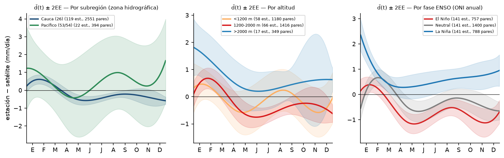{width=95%}

**Por subregión y ENSO.** El sesgo cambia de signo con el régimen: con El Niño el satélite sobreestima el total (+22,5 %) y con La Niña lo subestima (−5,9 %) [Tab30]. Es decir, el satélite atenúa la señal ENSO que sí registran las estaciones.

**ANOVA funcional sin grupos de una estación.** Se rediseñaron cuatro subregiones con varias estaciones cada una: Pacífico (22), Andina valle < 1200 m (48), ladera 1200-2000 m (56) y alta > 2000 m (15). La unidad es la curva media de cada estación. El estadístico F(t) se calibra con su máximo en t, permutando etiquetas de estación 2000 veces (Cuevas et al., 2004). Las subregiones difieren en la lluvia todo el año (F máx. = 14,0; p = 0,0005) y en el sesgo del satélite en diciembre-febrero (p = 0,003) [Tab33; Fig. 7].

**Por qué no la t pareada entre subregiones.** La t pareada supone que cada observación de un grupo tiene su par natural en el otro (la misma unidad medida dos veces), y prueba la media de las diferencias dentro de cada par. Las estaciones del Pacífico y las de la ladera andina son **poblaciones independientes**: no hay pares (ni siquiera el mismo tamaño, 22 frente a 56), y emparejarlas de forma arbitraria inventaría una correlación que no existe y cambiaría el resultado según el orden. Usamos la **t de Welch funcional** (Welch, 1947), que no supone varianzas iguales. Las razones de varianza entre grupos llegan a 100 (Pacífico frente a valle) [Tab34], así que la t con varianza combinada tampoco sería válida. Con calibración por permutación, Welch encuentra diferencias de lluvia entre todos los pares de subregiones (p ≤ 0,03). En el sesgo del satélite, en cambio, el Pacífico no difiere de las subregiones andinas (p = 0,08-0,35): solo difieren valle frente a ladera y alta.

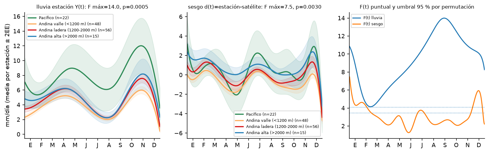{width=95%}

# 5. Red funcional, ablación y evaluación (fase 4)

## 5.1 Arquitectura, escala y partición

**Codificador funcional.** Seis neuronas z_k = ∫ w_k(t)(x(t) − x̄(t)) dt / 365 = a_kᵀ(W/365)(c − c̄), donde w_k(t) = φ(t)ᵀa_k tiene coeficientes aprendibles y W es la matriz de Gram calculada por cuadratura de Gauss-Legendre (W simétrica; Σ W = 365). A z se le agregan la altitud y el ONI estandarizados. **Cabezas:** lineal; MLP de una capa oculta (GELU, 28 neuronas); y KAN [8, 3, 5] programada en PyTorch con φ(x) = w_b·SiLU(x) + w_s·Σ c_i B_i(x), B-splines cúbicas con G = 5. Las cabezas KAN y MLP tienen **395 y 397 parámetros** (`sum(p.numel())`; diferencia 0,5 %) [Tab36]. **Decodificador:** ĉ = c̄_r + Σ_m s_m b_{r,m}, el FPCA de las curvas de estación de entrenamiento **del régimen r del año**, congelado. Se usa M = 5, el menor M ≥ 4 con ≥ 95 % de varianza en los tres regímenes (96,9 %, 96,1 % y 96,5 %) [Tab42]. **Pérdida:** (ĉ − c)ᵀ(W/365)(ĉ − c) + 0,01 · rugosidad de las w_k (matriz R de segundas derivadas), más λ(L1 + entropía) en la KAN.

**Escala.** Se modela la raíz de la curva suavizada en mm/día, reproyectada en la misma base. La primera versión usaba la curva ajustada a la raíz de los datos diarios; al elevarla al cuadrado se pierde la varianza diaria (desigualdad de Jensen) y el total anual cae de 1761 a 694 mm, lo que inflaba el sesgo del satélite hasta +281 %. Con la escala corregida, el "piso" de representación (raíz y cuadrado con K = 6) tiene un error L² relativo de 0,048 y un sesgo del total de −0,18 % [Tab37]. La reconstrucción en mm es max(ŷ, 0)² y solo recorta el 0,0006 % de los valores.

**Verificaciones.** La KAN aproxima exp(sin(πx₁) + x₂²) con RMSE de prueba 0,0019 (≤ 10⁻²). La cabeza lineal coincide con la regresión funcional ŷ(t) = α_r(t) + ∫β_r(s,t)x(s)ds + γ_r(t)ᵀcov, con β_r(s,t) = Σ_k Σ_m w_k(s)B_mk ψ_{r,m}(t): la diferencia máxima entre las dos formas es 0,0 en precisión doble (≤ 10⁻⁴) [Tab42].

**Partición (asesoría del 20-nov).** Entrenamiento y validación con 1981-1996; prueba con 1997-2003, evaluada en tres tramos: **T1 Niño 1997-1998**, **T2 Niña 1999-2000** y **T3 neutro 2001-2003**. Según el ONI anual, 1998 fue de transición (+0,04) y 2002 un Niño moderado (+0,51), así que T3 no es neutro puro. Se reservaron 14 estaciones (10 %, sorteadas con semilla 2026) que nunca entran al entrenamiento, porque el docente no publicó una lista. Los hiperparámetros se eligen con **validación cruzada temporal de ventana creciente** (entrenar hasta 1988/90/92/94 y validar en los dos años siguientes; Bergmeir y Benítez, 2012; Hyndman y Athanasopoulos, 2021). El FPCA y la estandarización se reestiman dentro de cada fold, así que no hay fuga. Cada cabeza tiene el mismo presupuesto: 3 configuraciones, máximo 2000 épocas, parada temprana con paciencia de 200, y como número de épocas final la mediana de los folds. Todo se repite con 3 semillas.

| Cabeza | CV (media ± DE, 4 folds) | Configuración elegida |
|---|---|---|
| lineal | 0,367 ± 0,049 | lr = 0,03 |
| MLP | 0,273 ± 0,054 | lr = 0,01, sin decaimiento |
| KAN | 0,279 ± 0,048 | lr = 0,01, λ(L1+entropía) = 10⁻³ |

: **Tabla 4.** CV score [Tab35b]. El fold 3 (validación 1993-1994) es el más fácil para todas las cabezas y el 1 (1989-1990) el más difícil [Tab35].

## 5.2 Resultados en prueba y por tramo ENSO

| Modelo | Prueba 1997-2003 | T1 Niño | T2 Niña | T3 neutro | KGE | Sesgo del total | Error de picos (días) |
|---|---|---|---|---|---|---|---|
| Satélite sin corregir | 0,461 | 0,505 | **0,399** | 0,473 | 0,473 | +17,3 % | 13,4 |
| Lineal | 0,444 | 0,427 | 0,449 | 0,452 | 0,447 | **+4,6 %** | 15,3 |
| MLP | **0,431** | 0,406 | 0,463 | **0,425** | 0,469 | +8,5 % | 15,7 |
| KAN | 0,495 | **0,391** | 0,653 | 0,458 | 0,430 | +15,9 % | 17,3 |

: **Tabla 5.** Error L² relativo medio por curva (menor es mejor) en las 750 curvas de prueba de 116 estaciones, con media de 3 semillas (DE entre semillas ≤ 0,023) [Tab37]. KGE en mediana.

**Comparaciones (bootstrap y Wilcoxon).** La unidad es la estación: se promedia el error de sus curvas de prueba. El bootstrap usa 2000 remuestreos de estaciones (Efron y Tibshirani, 1993) y se reporta junto a la prueba de rangos con signo de Wilcoxon pareada por estación [Tab38]:

- **MLP frente a satélite:** −0,029, IC95 [−0,057; −0,000]. El bootstrap lo declara apenas significativo, pero Wilcoxon no (p = 0,30): la MLP mejora en el 47 % de las estaciones, y la mejora media viene de unas pocas estaciones con mucho error. **Es una mejora marginal.** La lineal (−0,015, IC [−0,033; 0,001]) no supera al satélite.
- **KAN frente a MLP:** +0,065, IC [0,054; 0,076]; Wilcoxon p < 10⁻⁴. La MLP es mejor en el 91 % de las estaciones. El bootstrap y Wilcoxon coinciden.
- **Por tramo:** en **T1 Niño todas las cabezas mejoran al satélite** (KAN −0,113, IC [−0,155; −0,071], mejor en el 67 % de las estaciones) y la KAN le gana a la MLP (−0,016, IC [−0,025; −0,008]). En **T2 Niña todas empeoran** frente al satélite (lineal +0,050; MLP +0,061; KAN +0,253; todos los IC excluyen el 0). En T3 solo la MLP mejora, con IC [−0,092; −0,006] y Wilcoxon p = 0,28.

Conclusión cuantitativa: **la corrección funciona en la fase Niño y en el sesgo del total anual, pero no generaliza a la Niña intensa de 1999-2000.** Con bootstrap y Wilcoxon de acuerdo, la MLP supera a la KAN en el periodo completo; con los dos de acuerdo en el tramo Niño, la KAN supera a la MLP.

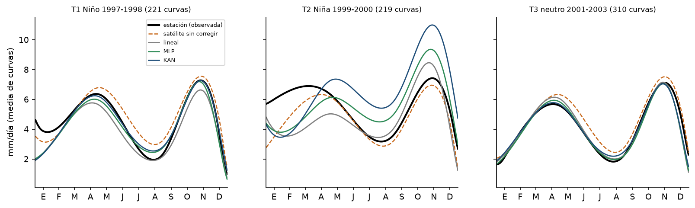{width=95%}

**Atenuación, adelantos y atrasos** [Tab37; Figs. 8-9]. La atenuación se mide como sd(predicción)/sd(observada) por curva, y el desfase como el rezago que maximiza la correlación cruzada (±60 días). En **T1 Niño** todos los modelos **atenúan** la curva (0,83-0,86) y la adelantan de 0 a 3 días: aplanan el ciclo porque el Niño reduce los picos. En **T2 Niña** la curva observada empieza el año muy húmeda (enero-marzo de 1999-2000 por encima de 6 mm/día) y los modelos no lo captan: predicen el valle de inicio de año y **amplifican** el pico de noviembre (KAN: razón 1,33 y +31 % en el total). El 38 % de las curvas de la KAN y el 29 % de las de la MLP tienen un desfase mayor de 15 días (satélite: 22 %). Es la falla que describió el profesor: la red "empuja" el segundo pico, pero llega tarde al inicio anómalo. En T3 la atenuación es cercana a 1 y el desfase de unos −3 días (leve adelanto).

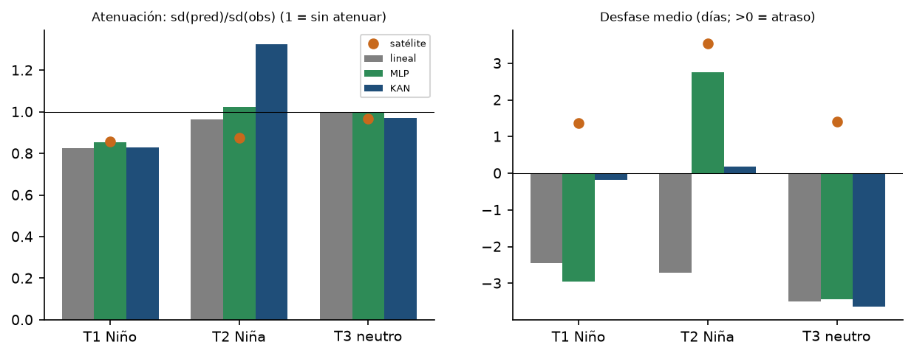{width=72%}

## 5.3 Aporte de cada covariable (ablación)

| Covariables | Lineal | MLP | KAN |
|---|---|---|---|
| Satélite solo | 0,437 | 0,413 | 0,414 |
| Altitud sola | 0,479 | 0,440 | 0,435 |
| **Satélite + altitud** | 0,437 | **0,403** | **0,400** |
| Satélite + ONI | 0,444 | 0,448 | 0,512 |
| Satélite + altitud + ONI | 0,444 | 0,431 | 0,495 |

: **Tabla 6.** Error L² relativo en prueba por conjunto de covariables, con media de 3 semillas [Tab39]. Satélite sin corregir: 0,461.

- **El satélite es la covariable principal.** "Altitud sola" es la peor en las tres cabezas (para la lineal es peor que no corregir: 0,479).
- **La altitud suma** cuando la cabeza es no lineal: satélite + altitud mejora al satélite solo en la MLP (0,413 → 0,403) y en la KAN (0,414 → 0,400). Es coherente con la relación lluvia-altura no lineal de §1.4. En la lineal no aporta.
- **El ONI empeora la prueba.** Quitarlo mejora a la KAN en −0,094 (IC [−0,108; −0,081], mejor en el 92 % de las estaciones) y a la MLP en −0,027 (IC [−0,032; −0,022]) [Tab38]. El ONI es constante dentro de cada año, así que en entrenamiento solo hay **16 valores distintos**, y la red memoriza su efecto. La Niña de 1999-2000 está en el extremo del rango y la KAN la extrapola con sus splines.
- **El mejor modelo en prueba es KAN o MLP con satélite + altitud** (0,400-0,403), un 13 % menos de error que el satélite sin corregir. La configuración que se fijó por validación cruzada antes de ver la prueba fue la de las tres covariables, y es la que se reporta como principal. No se cambió a posteriori para no usar la prueba al elegir el modelo.

**FPCA por régimen frente a global.** Con el decodificador global, la lineal mejora (−0,025) y la KAN también (−0,060); la MLP empeora (+0,007) [Tab38]. Separar por régimen es más correcto en el FPCA (Fig. 5), pero deja solo 4 años de entrenamiento para Niño y 4 para Niña, y esa pérdida de muestra pesa más que el sesgo que corrige. Lo dejamos como hallazgo y limitación.

## 5.4 Interpretación

**Funciones de peso.** En la KAN (Fig. 10, izq.), w₁, w₃ y w₅ contrastan el inicio del año (enero-marzo, peso positivo) con la temporada seca de mitad de año (mayo-agosto, peso negativo): miden si el satélite vio un primer semestre húmedo o seco. w₄ y w₆ crecen hacia octubre-diciembre y resumen la segunda temporada lluviosa. En la lineal (der.), casi todas las w_k pasan de negativas en enero-febrero a positivas en octubre-diciembre: contrastan las dos mitades del año. w₄ hace lo contrario.

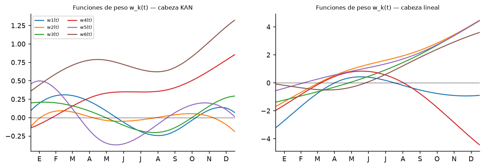{width=85%}

**Activaciones de la KAN, ajuste simbólico y poda.** Las activaciones de la primera capa son suaves y casi monótonas (Fig. 11). La más importante (z₆ → neurona 2) se ajusta a a·tanh(bx + c) + d con R² = 1,000; la de la altitud (→ neurona 3) a una tanh con R² = 0,950; la del ONI necesita un cúbico (R² = 0,94), una forma más irregular, coherente con el sobreajuste de §5.3 [Tab45]. La poda con L1 + entropía (umbral del 2 % de la importancia máxima por capa y re-ajuste de 300 épocas; Liu et al., 2024) quita en promedio 8 de las 39 aristas, pero **empeora el CV score** (0,278 → 0,301) y el error de prueba (+0,019; IC [0,016; 0,022]) [Tab35, Tab38]. La KAN no estaba sobreparametrizada: las aristas débiles también aportan.

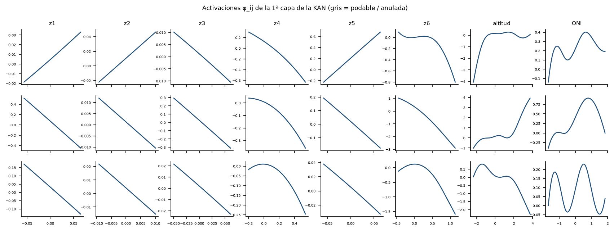{width=95%}

**¿Las B-splines captan sequía y lluvia?** Para cada entrada se mueve su valor del percentil 10 al 90, con las demás en la mediana, y se mide el cambio de la curva decodificada en las temporadas secas (diciembre-febrero y junio-agosto) y lluviosas [Tab43]. En la KAN casi todas las entradas **aportan** lluvia (más días con efecto positivo: 6811 frente a 1140 de atenuación); solo z₄ y z₅ **atenúan** en parte del año (z₄ resta 0,23 mm/día en la temporada lluviosa del régimen neutro). La lineal y la MLP están más equilibradas (4637/3736 y 5057/3284). La KAN casi no tiene funciones que "resten" lluvia, lo que es coherente con que sobreestime en la Niña. Es la asimetría aporte/atenuación que advirtió el profesor.

**MLP: activaciones y autoencoder disperso.** Nueve neuronas ocultas se correlacionan con la lluvia de ambas temporadas (r de 0,63 a 0,82); otras seis codifican casi solo el ONI (|r| de 0,89 a 0,96 con el ONI y |r| < 0,30 con la lluvia) [Tab44; Fig. 12]. Un autoencoder disperso (56 rasgos, penalización L1, R² de reconstrucción 0,997; Bricken et al., 2023; Cunningham et al., 2023) separa rasgos que se activan en pocas curvas, como el rasgo 50 (activo en el 2,7 % de las curvas, r = 0,79 con la lluvia seca) y el rasgo 32 (2,7 %, r = 0,67), de rasgos amplios ligados al ONI. **Ningún rasgo ni neurona se correlaciona con |r| > 0,1 en sentidos opuestos con la temporada seca y la lluviosa:** la MLP representa sobre todo "año más o menos lluvioso", no "sequía frente a lluvia", y por eso tampoco capta el adelanto de la Niña.

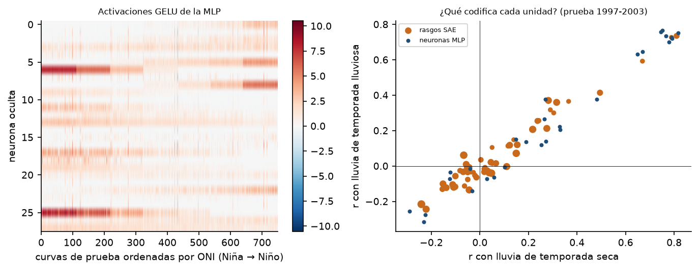{width=85%}

**Peores casos.** Los tres peores de la KAN son de la estación 2624700120 en 1999 y 2001 y de la 2614100104 en 2001 [Tab46]. Su total observado (1002, 571 y 522 mm) es menos de la mitad del satelital (2210, 1877 y 1385 mm). Son estaciones de ladera (1380-1956 m) con años anómalamente secos; no descartamos un problema de dato no detectado.

**Predicciones de las estaciones reservadas.** Se entregan en `predicciones_estaciones_reservadas.csv` (`station_id, year, day, value_mm`) con la MLP, la cabeza de menor CV score, promediando 3 semillas, para todos los años de las 14 estaciones reservadas. En 1997-2003 su error L² relativo es 0,413, frente a 0,419 del satélite [Tab37].

# 6. Limitaciones

1. La fuente del criterio nacional ">45 %" no se encontró; la elección se sustenta en la cobertura del Pacífico y en el umbral anual del 25 %.
2. Hay 145 estaciones sin coordenadas dentro de la malla (no son códigos del catálogo IDEAM) que quedan fuera. El Pacífico tiene más imputación (mediana de 89 % de datos) y el satélite está censurado en 200 mm/péntada, justo donde más llueve.
3. La correlación diaria entre estaciones es baja (pepita del 65 %), así que toda imputación diaria es ruidosa (r ≈ 0,55); en totales de 30 días mejora (r ≈ 0,79).
4. La prueba tiene 7 años y la Niña de 1999-2000 es un evento extremo; la mejora sobre el satélite es marginal y depende del tramo.
5. FPCA por régimen: solo 4 años Niño y 4 Niña en entrenamiento.
6. No se ajustaron señales seno/coseno para corregir el desfase ni se probaron pesos de L1/entropía optimizados por separado (la pregunta quedó abierta en la asesoría).
7. Las estaciones reservadas son un sorteo propio.

# 7. Reproducibilidad

`../venv/bin/python proyecto_final.py` ejecuta las fases 0, 1, 2, 3, 3b, la interfaz y la fase 4 (unos 10 min; semilla 2026; Python 3.12, numpy 2.5.4, pandas 3.1.1, scipy 1.18.1, torch 2.15 CPU). `Rscript proyecto_final.R` ejecuta las fases 0, 0b, 1, 2 y 3 en R 4.3.3 (fda 6.3.0, fda.usc 2.2.0). Los logs de esta versión están en `cache/log_*_v2.txt`. Todas las tablas citadas como [TabXX] están en `tablas/` y `tablas_R/`.

# Referencias

- Bergmeir, C., & Benítez, J. M. (2012). On the use of cross-validation for time series predictor evaluation. *Information Sciences, 191*, 192-213. https://doi.org/10.1016/j.ins.2011.12.028
- Bricken, T., et al. (2023). *Towards monosemanticity: Decomposing language models with dictionary learning*. Transformer Circuits Thread.
- Climate Hazards Center, UCSB. *CHIRPS v2.0 README y cabecera netCDF pentadal*. https://data.chc.ucsb.edu/products/CHIRPS/v2.0/
- Cruz-Roa, A. F., & Barrios, M. I. (2018). Estimación de datos faltantes de lluvia mensual... cuenca andina tropical. *Idesia, 36*(3), 107-117. https://doi.org/10.4067/S0718-34292018005001601
- Cuevas, A., Febrero, M., & Fraiman, R. (2004). An anova test for functional data. *Computational Statistics & Data Analysis, 47*(1), 111-122.
- Cunningham, H., et al. (2023). Sparse autoencoders find highly interpretable features in language models. arXiv:2309.08600.
- Duarte, Y. E., et al. (2025). Deep learning and time series for the prediction of monthly precipitation. A case study in the Department of Boyacá, Colombia. *Ingeniería, 30*(1), e21930. https://doi.org/10.14483/23448393.21930
- Efron, B., & Tibshirani, R. J. (1993). *An introduction to the bootstrap*. Chapman & Hall/CRC.
- Farr, T. G., et al. (2007). The Shuttle Radar Topography Mission. *Reviews of Geophysics, 45*(2), RG2004.
- Funk, C., et al. (2015). The climate hazards infrared precipitation with stations. *Scientific Data, 2*, 150066. https://doi.org/10.1038/sdata.2015.66
- Gómez Sepúlveda, J. I., Lafaurie Suárez, J. A., & Mendoza García, M. C. (2024). *Modelo de predicción de precipitación acumulada... (LSTM) e integración de datos satelitales* [Maestría]. Pontificia Universidad Javeriana Cali.
- Goovaerts, P. (2000). Geostatistical approaches for incorporating elevation into the spatial interpolation of rainfall. *Journal of Hydrology, 228*, 113-129.
- Hyndman, R. J., & Athanasopoulos, G. (2021). *Forecasting: Principles and practice* (3.ª ed.), §5.10. OTexts.
- IDEAM. (2020). *Instructivo para la elaboración del mapa del índice de la precipitación* (M-GDI-M-I002).
- Liu, Z., et al. (2024). KAN: Kolmogorov-Arnold networks. arXiv:2404.19756.
- Martínez Pedraza, A., & Serna Cuenca, J. (2018). *Validación de las estimaciones de precipitación con CHIRPS e IRE/IDEAM* (NT IDEAM-METEO/002-2018).
- NOAA Climate Prediction Center. *Oceanic Niño Index (ONI)*. https://www.cpc.ncep.noaa.gov/products/analysis_monitoring/enso/oni/
- NOAA NCEI. (2021). *Normals calculation methodology 2020*.
- Ramsay, J. O., & Silverman, B. W. (2005). *Functional data analysis* (2.ª ed.). Springer.
- Russi Peña, J., & Larrahondo, E. (2017). *Comparación de métodos de estimación de datos faltantes en series de precipitación diaria en el Valle del Cauca* [Trabajo de grado]. Universidad del Valle.
- Shepard, D. (1968). A two-dimensional interpolation function for irregularly-spaced data. *Proc. 23rd ACM National Conference*, 517-524.
- Teegavarapu, R. S. V., & Chandramouli, V. (2005). Improved weighting methods... for estimation of missing precipitation records. *Journal of Hydrology, 312*, 191-206.
- Welch, B. L. (1947). The generalization of 'Student's' problem when several different population variances are involved. *Biometrika, 34*, 28-35.
- WMO. (2017). *WMO guidelines on the calculation of climate normals* (WMO-No. 1203).

*Uso de IA generativa declarado en el anexo aparte (`ANEXO_IA.docx`).*
