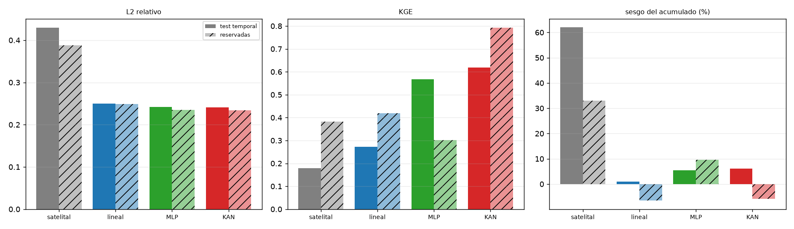
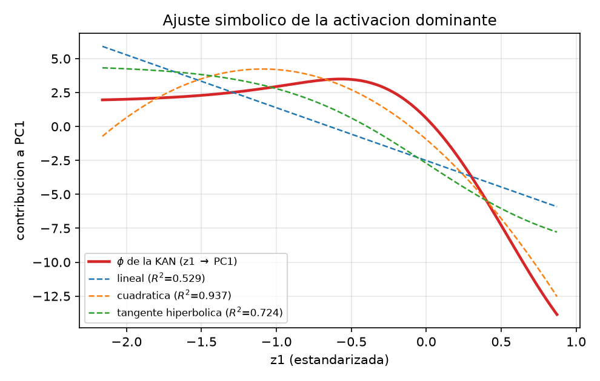
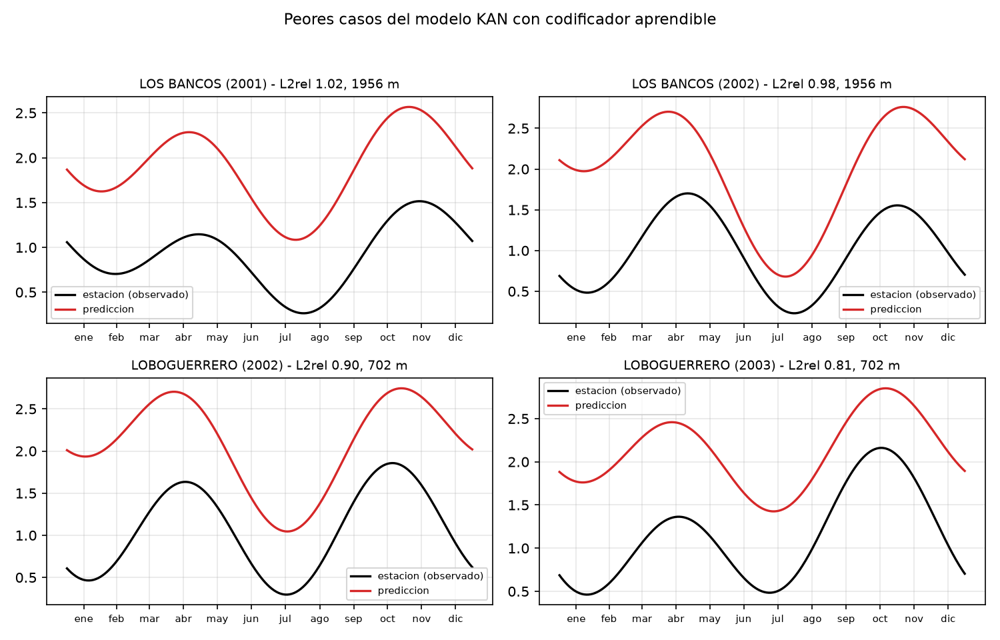

# Resumen

Se analiza la precipitación del suroccidente colombiano con herramientas de análisis de datos
funcionales, usando dos fuentes: 186 estaciones pluviométricas terrestres (1981–2003, ventana
confirmada por la fe de erratas del docente) y un producto satelital pentadal en malla de
0,05° (1.443 píxeles, 1981–2012). Cada serie
estación-año y píxel-año se representa como una curva anual sobre una base de Fourier de
dimensión K=5 ajustada por mínimos cuadrados penalizados con factorización de Cholesky
propia. El análisis exploratorio funcional (media, varianza, covarianza, derivadas analíticas,
profundidades de Fraiman–Muniz y *modified band depth*, boxplot funcional y FPCA) confirma un
ciclo bimodal, concentra el 89,6 % de la variabilidad en dos componentes e identifica 54 de
3.567 curvas atípicas que corresponden al régimen hiperhúmedo del Pacífico, no a errores de
dato. La comparación entre fuentes exigió resolver tres problemas que el enunciado no
anticipa: los identificadores de estación no son códigos del Catálogo Nacional de Estaciones
del IDEAM —solo su prefijo de subzona hidrográfica es utilizable—; las dos fuentes habían
sido preprocesadas en escalas no comparables, lo que inflaba el satélite por un factor 2,14
por efecto de la desigualdad de Jensen; y el emparejamiento estación–píxel por máxima
correlación, que parecía razonable, resultó ser una **selección post-hoc de ruido**: con el
catálogo oficial de coordenadas publicado el 9 de noviembre de 2026 se comprueba que elegía
píxeles a 118 km de mediana de la estación verdadera y **acertaba el píxel correcto en 0 de
38 casos**. Rehecho el emparejamiento con coordenadas reales (121 estaciones a 2,26 km
mediana del centro de su píxel), el satélite sobreestima el acumulado anual un 25 % y lo hace
**todos los días del año**, con un sesgo que crece hacia el norte (ρ = −0,38 con la latitud) y
que es mayor en el fondo del valle que en la ladera alta (ρ = +0,30 con la altitud). Dos
conclusiones de la versión con centroides no sobreviven al emparejamiento correcto: la deriva
temporal del sesgo y su dependencia de la longitud resultaron espurias. Finalmente se entrena una red funcional (codificador de neuronas
funcionales con pesos en B-splines aprendibles —integral verificada a 1,1e−13—, decodificador
FPCA estimado solo con entrenamiento, cabezas lineal, MLP y KAN con presupuesto de parámetros
igualado) que predice la curva de estación a partir de la del píxel y reduce el error L²
relativo a menos de la mitad del satélite crudo. El análisis de interpretabilidad muestra que
las funciones peso concentran hasta el 77 % de su masa en las dos temporadas de lluvia, que
la KAN **poda tres de las cinco neuronas funcionales** y que su activación dominante es un
polinomio cúbico con R² = 0,987 — relación casi lineal que explica por qué la cabeza lineal
compite con la KAN. La ablación del codificador arroja un resultado contraintuitivo y se
reporta como tal: **el operador fijo W^(1/2) generaliza mejor que los pesos aprendidos**,
porque con K=5 ya genera todo el espacio de curvas y actúa como regularizador.

# 1. Datos y preprocesamiento (Fase 1b)

**Fuentes.** (i) Precipitación diaria de estaciones del IDEAM en la cuenca alta del Cauca,
el Patía y la vertiente pacífica sur; (ii) producto satelital pentadal (72 valores/año,
mm/día) en malla regular de 0,05° que cubre lon −77,525 a −75,725 y lat 3,075 a 4,975.

**Depuración** (`preproc_4_1.py`, trazabilidad por paso en `tablas/trazabilidad_4_1.csv`):
se anularon 50 valores diarios > 300 mm (máximo detectado: 859,4 mm); se eliminaron 80
estación-mes cuyo total mensual aparecía concentrado en un único día (27 de ellos detectados
solo por la regla de cierre de mes); se marcaron 321 rachas de ≥45 días consecutivos en cero;
se descartaron 1.033 pares estación-año por cobertura insuficiente; solo 52 valores fueron
interpolados. Resultado: **186 estaciones** (de 323 presentes en los archivos) y **3.567
curvas estación-año** en el período efectivo **1981–2003**, que es la ventana verificada del
proyecto según la fe de erratas del docente, más **46.176 curvas
píxel-año** (1.443 × 32 años completos).

# 2. Construcción de los datos funcionales (Fase 1)

Se compararon dos bases construidas explícitamente: B-splines cúbicas por la recursión de
Cox–de Boor y Fourier. Para cada curva se resuelve

$$\hat{c} = \arg\min_c \sum_{i} \big(y_i - \Phi(t_i)c\big)^2 + \lambda\, c^{\top}\!R\,c,
\qquad R = \int \Phi''(t)\Phi''(t)^{\top} dt,$$

mediante las ecuaciones normales factorizadas con **Cholesky implementada a mano** (sin `lm()`
ni `lstsq`). La selección de K y λ se hizo con error cuadrático medio, validación cruzada y
validación cruzada generalizada (VCG).

: **Tabla 1.** Selección de base y verificación de la matriz de suavizado.

| Criterio | Fourier K=5 | B-spline |
|---|---|---|
| VCG estaciones | **3,0401** | 3,0418 (K=6) |
| VCG satélite | **0,2749** | 0,2804 (K=8) |
| Empalme 31-dic / 1-ene | **0,0000** | 0,4136 |
| Segundo pico del perfil medio | día 304 (31-oct) | día 317 |
| $\max|S\cdot S - S|$ | 3,47e−17 | — |
| tr(S) = K | 5,000000 | — |
| $\hat{\sigma}^2$ residual | 2,0951 (escala √mm) | — |

El hallazgo que decidió la base fue gráfico: con B-splines la curva **se desploma al cerrar el
año** (0,61 el 31 de diciembre frente a 1,03 el 1 de enero), porque la base no impone
periodicidad y el último tramo polinómico queda sin datos a la derecha. Fourier es periódica
por construcción, gana en VCG en las dos fuentes y además es interpretable: los dos armónicos
**son** los dos pasos anuales de la Zona de Convergencia Intertropical sobre el valle. Como
las dos fuentes, seleccionadas por separado, convergen en la misma base y dimensión, sus
coeficientes son comparables componente a componente (Fase 3) sin reproyección.

La implementación en R (`proyecto_final_R.R`) reproduce esta fase de forma independiente
—bases a mano, `crossprod`/`solve`, Cholesky propia, GCV, tr(S) y bandas punto a punto— y
sirve como verificación cruzada de la implementación en Python: sobre las **3.567 curvas
comunes**, $\max|\text{coef}_R-\text{coef}_{py}| = 7{,}7\mathrm{e}{-}05$,
$\max|\text{curva}_R-\text{curva}_{py}| = 9{,}8\mathrm{e}{-}05$ y RMSE entre
implementaciones $1{,}3\mathrm{e}{-}05$, con grados de libertad efectivos idénticos
(tr(S) = 4,736 con λ = 10⁵ en ambas). El residuo es del orden de la cuadratura: R usa la
matriz de rugosidad analítica de la base de Fourier y Python la aproxima en una malla de
3.651 puntos (`tablas/R_verificacion_python.csv`, Figura 1c).


# 3. Análisis exploratorio funcional (Fase 2)

Todo estadístico se calculó **a mano** y se verificó contra una referencia independiente:
la media funcional con acumulador explícito frente a la identidad analítica $\Phi(t)\bar{c}$,
a `numpy` y a `skfda` (error máximo 6,2e−15); las profundidades de Fraiman–Muniz y *modified
band depth* implementadas desde su definición con pesos de cuadratura frente a `skfda`
(1,1e−4 y 8,1e−5); el FPCA como problema de autovalores generalizado con la matriz de Gram
frente a `skfda` (correlación de scores 1,000000).

**Ciclo anual.** Bimodal en ambas fuentes. Máximos de la media en los días 112 (22-abr) y 304
(31-oct) para estaciones; el satélite atrasa el primero y adelanta el segundo. La desviación
estándar funcional de las estaciones es mínima en marzo (0,606) y máxima a mediados de
noviembre (0,785): **la variabilidad interanual se concentra en la segunda temporada**, que es
justamente la sensible al ENSO. La varianza total integrada es 184,55 en estaciones y 273,68
en el satélite, porque la malla incluye la vertiente pacífica hiperhúmeda que la red
terrestre no cubre.

**Correlación funcional.** Superficies de bandas anchas: dentro de un mismo año las dos
temporadas se mueven juntas (forzamiento común de gran escala). Correlación entre el 15 de
abril y el 27 de octubre: 0,775 en estaciones y 0,923 en el satélite, cuya mayor suavidad
refleja el promedio espacial del píxel.

: **Tabla 2.** FPCA de las curvas de estación (implementación propia, verificada con `skfda`).

| Componente | Varianza explicada | Acumulada | Lectura |
|---|---|---|---|
| PC1 | 79,6 % | 79,6 % | nivel de lluvia (ρ = 0,92 con el acumulado observado) |
| PC2 | 10,0 % | **89,6 %** | contraste entre la primera y la segunda temporada |
| PC3 | 5,0 % | 94,6 % | asimetría del segundo semestre |
| PC4–PC5 | 5,4 % | 100 % | residual |

**Profundidad y atípicas.** Con el boxplot funcional de Sun & Genton (2011) sobre MBD se
identifican **54 de 3.567** curvas atípicas (1,51 %) y **ninguna** en el satélite. No se
reparten al azar: se concentran en cuatro estaciones (`5300000203`, `5300900102`,
`5301100101`, `5400000201`) con acumulados de 15.000 a 23.800 mm/año. Son el régimen
hiperhúmedo del Chocó biogeográfico, no errores: descartarlas eliminaría la señal climática
más fuerte del área. La consecuencia metodológica es que la población de estaciones **no es
homogénea** y cualquier modelo posterior debe estratificar, usar estimadores robustos o
incorporar una covariable de régimen.

**ENSO.** Con el índice Niño 3.4 (NOAA/PSL) promediado por año civil, el acumulado anual
medio es 1.939 mm (mínimo 1.556 en 1992, máximo 2.398 en 1984) y

- El Niño (6 años): **1.812 mm**; Neutro (11): 1.914 mm; La Niña (6): **2.113 mm**
- Spearman acumulado vs ONI anual: **−0,403** (con la ventana DJF, −0,270)

La Niña llueve un **17 % más** que El Niño. Se reportan las dos ventanas porque la
clasificación DJF hereda el evento del invierno previo y desalinea años como 1988 (El Niño en
DJF, La Niña fuerte desde mayo); para un acumulado de año civil, el ONI medio anual es el
criterio pertinente. Con n = 23 la correlación es consistente pero no concluyente al 5 %.

**Gradiente orográfico.** Sobre los 1.443 píxeles: acumulado mínimo 1.013 mm, mediana 3.074
mm, máximo 6.170 mm; vertiente pacífica (lon ≤ −76,8°) 5.080 mm/año frente a 1.855 mm/año en
el valle interandino (razón 2,74), con Spearman acumulado–longitud de **−0,813**. El gradiente
zonal domina la variabilidad espacial muy por encima de la interanual.

**Validación de la representación.** Comparando con el acumulado observado: r de Pearson
0,973 y ρ de Spearman 0,927, pero sesgo de −58,2 % en magnitud. La curva con K=5 en escala
√P preserva **forma y ordenamiento**, no el total; por eso todo análisis de magnitud de este
informe usa el acumulado observado y la representación funcional se reserva para forma,
derivadas, profundidad y FPCA.

# 4. Comparación entre fuentes (Fase 3)

## 4.1 Dos obstáculos que hubo que resolver antes de comparar

**(a) Los identificadores de estación no son códigos del CNE.** Los 186 `STATION_ID` de diez
dígitos no coinciden con el campo `Codigo` del Catálogo Nacional de Estaciones del IDEAM
(29.320 registros descargados de `datos.gov.co`, dataset `hp9r-jxuu`): 0 de 186 emparejan
literalmente, y la mejor regla de reescritura ensayada (134/186) resulta espuria —ubica las
estaciones en Antioquia, Quindío y Risaralda y solo 21 de las 134 caen dentro de la malla
satelital. Lo que **sí** es válido es el prefijo: los cuatro primeros dígitos son la
**subzona hidrográfica**, verificable contra el CNE (429 estaciones del CNE en la subzona
2610, 513 en 2612, 398 en 2613). Con esa única información se adoptó al principio el
**centroide de la subzona** como coordenada aproximada (±10 km en longitud, ±24 km en
latitud), declarando la incertidumbre.

Esa aproximación dejó de ser necesaria: el **9 de noviembre de 2026** el docente publicó en
la consigna del proyecto el catálogo oficial de estaciones de la CVC
(`CVC_Wheather_Stations_Long_Lat.csv`, 238 estaciones con longitud y latitud, y
`CatalogoEstacionesElevacion.xlsx`, 229 con elevación). El cruce por código recupera la
posición real de **134 de las 186 estaciones depuradas** y la altitud de 134; de ellas
**121 caen dentro del dominio satelital** —casi el doble de las 65 que sugerían los
centroides— y la altitud real va de 232 a 3.690 m, con mediana 1.180 m.

La conclusión estructural se mantiene, pero más precisa: **las dos fuentes no cubren la
misma región** (52 estaciones quedan sin coordenada en el catálogo y otras 13 fuera de la
malla), y la comparación pareada solo es legítima en la intersección de 121 estaciones.

**(b) Las dos fuentes no estaban en la misma escala.** La Fase 1 ajustó las estaciones sobre
√P de valores **diarios** y el satélite sobre √P de promedios **pentadales**. Como la raíz es
cóncava, por la desigualdad de Jensen $\overline{\sqrt{P}} \le \sqrt{\overline{P}}$, y la
brecha crece con la intermitencia de la lluvia. Comparar así no mide el sensor, mide el
preprocesamiento. Se reconstruyeron por tanto las curvas de estación con **el mismo
preprocesamiento del satélite** (agregación a 72 pentadas, mm/día, raíz, Fourier K=5 por
mínimos cuadrados ponderados con Cholesky propia).

: **Tabla 3.** Efecto de la escala de ajuste sobre 3.567 curvas comunes.

| Representación | Integral anual media | Sesgo vs acumulado observado |
|---|---|---|
| Ajuste diario (Fase 1) | 810 mm/año | −58,2 % |
| Ajuste pentadal (Fase 3) | 1.483 mm/año | **−23,5 %** |
| Acumulado observado | 1.939 mm/año | — |

La razón pentadal/diario es 2,14, y la razón satélite/estación pasa de 3,32 a 1,62 con los
pares de entonces: el **51 % del desacuerdo original era artefacto de representación**, no
sesgo del satélite. Con el emparejamiento georreferenciado (§4.3) la razón baja aún más, a
**1,248**: entre la escala de ajuste y la posición de las estaciones se explica la mayor parte
de lo que parecía un sesgo enorme del sensor.

## 4.2 Emparejamiento estación–píxel: por qué la correlación máxima es un mal criterio

Con la coordenada oficial el emparejamiento ya no se estima: la estación se asigna al píxel
que la **contiene**. Resultado: 121 estaciones sobre 107 píxeles distintos, a una distancia
mediana de **2,26 km** del centro del píxel (la malla de 0,05° mide 5,5 km de lado).

El primer criterio ensayado —el píxel de máxima correlación de anomalías mensuales a menos de
35 km del centroide— resultó **inadmisible**, y el catálogo permite demostrarlo. Sobre las 38
estaciones comunes a los dos métodos, el píxel que ese criterio elegía está a una distancia
mediana de **118,8 km** de la estación verdadera (que se encuentra a 2,2 km), y **acertó el
píxel correcto en 0 de 38 casos**. La correlación que exhibía era además mayor que la real
(0,533 frente a 0,468): el criterio no estaba midiendo proximidad sino **seleccionando ruido
favorable** entre decenas de candidatos, un sesgo de selección post-hoc clásico.

El control correcto tampoco es el que se usó primero (píxel real contra píxel al azar): en
una región donde el forzamiento de gran escala —ENSO— domina la variabilidad interanual, dos
puntos cualesquiera ya correlacionan. El control informativo es el **perfil de correlación
contra la distancia**:

: **Tabla 3b.** Decaimiento espacial de la correlación de anomalías mensuales (1981–2003).

| Distancia estación–píxel | Pares | Correlación media |
|---|---|---|
| < 5 km | 41 | **0,406** |
| 5–10 km | 136 | 0,393 |
| 10–20 km | 551 | 0,395 |
| 20–40 km | 2.053 | 0,390 |
| 40–80 km | 6.311 | 0,345 |
| 80–160 km | 13.773 | 0,277 |
| 160–400 km | 3.755 | 0,266 |

Hay señal local genuina (+0,128 entre los extremos) sobre un piso regional alto de 0,27, que
es precisamente el forzamiento común. La escala de decorrelación es de unos 40 km: por eso un
error de posición de 100 km destruye la comparación mientras uno de 5 km es inocuo.


## 4.3 Resultados de la comparación (2.324 pares estación-año georreferenciados)

: **Tabla 4.** Comparación funcional pareada estación vs satélite, con el emparejamiento
por coordenada oficial.

| Métrica | Valor |
|---|---|
| Sesgo medio integrado (estación − satélite) | −0,423 √(mm)/día |
| Sesgo máximo / mínimo | −0,308 (día 68) / −0,542 (día 172) |
| Días con banda bootstrap al 95 % que excluye el cero (B = 1.000) | **365 de 365 (100 %)** |
| Integral anual media estación vs satélite | 622 vs 777 (razón **1,248**) |

El satélite sobreestima **todos los días del año**, y la sobreestimación es máxima en junio
(día 172), en la transición seca entre temporadas, cuando la lluvia real es baja y el error
relativo del sensor crece.

Lo más relevante es lo que **cambia** respecto al emparejamiento por centroides: la estructura
del sesgo era en buena parte artefacto.

: **Tabla 4b.** Correlación de Spearman del sesgo integrado con cada variable, antes y
después de georreferenciar.

| Variable | Con centroides | Con coordenada real |
|---|---|---|
| Altitud | −0,308 | **+0,296** (signo invertido) |
| Longitud | −0,363 | −0,033 (desaparece) |
| Latitud | — | **−0,378** |
| Año | −0,457 | −0,038 (desaparece) |
| Distancia al píxel | — | −0,062 |

Tres conclusiones de la versión anterior no sobreviven. La **deriva temporal** (ρ = −0,457)
era espuria: con pares correctos no hay tendencia del sesgo con el año (−0,038). La
dependencia con la **longitud** también se disuelve (−0,033) y la reemplaza una dependencia
con la **latitud** (−0,378): el satélite sobreestima más hacia el norte del dominio. Y el
signo de la relación con la **altitud se invierte** (+0,296): el sesgo —negativo en todo el
rango— se hace *menos* negativo con la altura, es decir, la sobreestimación del satélite es
**mayor en el fondo del valle** que en la ladera alta. Para la razón satélite/estación esto
significa 1,248 y no 1,62: al emparejar bien, parte del desacuerdo atribuido al sensor
desaparece.

(Importante no confundir este resultado con el de §5.6: el *sesgo bruto del satélite* es menor
en montaña, mientras que el *error del modelo corregido* es mayor allí, porque la corrección
aprendida en promedio resulta excesiva donde la lluvia observada es baja.)


# 5. Red funcional, ablación y evaluación (Fase 4)

## 5.1 Arquitectura

$$\text{curva satelital} \;\xrightarrow{\;W^{1/2}\;}\; z \in \mathbb{R}^5
\;\oplus\; (\text{altitud, lon, lat}) \;\xrightarrow{\;\text{cabeza}\;}\; \text{5 scores}
\;\xrightarrow{\;\text{FPCA}^{-1}\;}\; \text{curva de estación}$$

- **Codificador funcional con neuronas aprendibles**. Cada neurona calcula un producto
  interno funcional $z_k=\langle w_k, X\rangle=\int w_k(t)X(t)\,dt$, con la función peso
  expandida en **base B-spline cúbica** ($w_k(t)=\sum_b a_{kb}B_b(t)$, 8 nodos interiores,
  12 coeficientes) y los $a_k$ **estimados por descenso de gradiente**. La integral no se
  aproxima con una suma sobre la rejilla: se reduce al producto matricial
  $z_k=a_k^{\top}W_{B\Phi}c$, con $W_{B\Phi}=\int B(t)\Phi(t)^{\top}dt$ calculada por
  cuadratura de Simpson sobre 36.501 nodos. Verificación independiente contra cuadratura
  fina de 400.003 nodos: **error relativo 1,1e−13** (el trapecio sobre los 365 días daba
  8e−3, insuficiente). Como referencia teórica se conserva el operador fijo
  $z=W^{1/2}c_{sat}$, con $W=\int\Phi\Phi^{\top}dt$ (traza 1.092,00), que preserva la
  distancia L² entre curvas; los $a_k$ pueden inicializarse en él ("inicio informado").
- **Decodificador FPCA** estimado **solo con entrenamiento** (sin fuga); con el conjunto
  georreferenciado la varianza explicada es 63,1 / 16,9 / 9,0 / 6,0 / 4,9 %; M=5 para el
  umbral del 99 %; ortonormalidad $\max|B^{\top}WB-I| = 8{,}9\mathrm{e}{-}16$.
- **Pérdida**: $(\hat{c}-c)^{\top}W(\hat{c}-c)/T + \lambda\,\mathrm{rug}(w_k)$ con
  $R=\int\Phi''\Phi''^{\top}dt$ analítica y λ = 1e−6.
- **No negatividad**: se modela en √P y se reconstruye como $\max(\text{curva},0)^2$; días
  recortados 0,00 % (lineal), 0,01 % (MLP), 0,15 % (KAN).
- **Particiones**: la **guía corregida** que acompaña a la fe de erratas del docente
  (9 de noviembre de 2026) fija la partición temporal en **1981–1995 / 1996–2000 /
  2001–2003**, que es la aplicada aquí: 1.351 pares de entrenamiento, 398 de validación y
  260 de prueba. (La guía inicial planteaba 1981–2005 / 2006–2009 / 2010–2013 sobre una
  serie que no pudo recuperarse más allá de 2003.) Además, **16 de las 121 estaciones (13 %)
  quedan reservadas** —315 pares nunca vistos— para medir extrapolación espacial. El docente
  no publicó una lista de estaciones reservadas, de modo que el sorteo es propio y
  reproducible (semilla 2026). Tres semillas de entrenamiento (11, 23, 37).

: **Tabla 5.** Verificaciones exigidas por la rúbrica.

| Verificación | Resultado |
|---|---|
| Cabeza lineal (LBFGS, float64) ≡ regresión funcional cerrada por Cholesky propia | $\max|\mathrm{dif}| = 6{,}7\mathrm{e}{-}09$ (tolerancia 1e−4) ✔ |
| KAN sobre $f(x_1,x_2)=\sin(\pi x_1)+x_2^2$ | RMSE 0,0026 frente a sd 0,764 ✔ |
| Parámetros igualados (`sum(p.numel())`) | KAN 756 vs MLP 761 → 0,7 % ✔ (cabeza lineal: 45) |

## 5.2 Resultados

: **Tabla 6.** Las cuatro métricas (media ± sd entre tres semillas).

| Bloque | Modelo | L² relativo | KGE | Sesgo acum. (%) | Error picos (d) |
|---|---|---|---|---|---|
| Temporal | satelital sin corregir | 0,4293 | 0,1782 | +62,0 | **8,6** |
| Temporal | lineal | 0,2495 ± 0,0000 | 0,2725 | **+0,9** | 10,7 |
| Temporal | MLP | 0,2420 ± 0,0009 | 0,5679 | +5,4 | 10,6 |
| Temporal | **KAN** | **0,2405 ± 0,0003** | **0,6178** | +6,1 | 10,4 |
| Reservadas | satelital sin corregir | 0,3876 | 0,3820 | +32,9 | 18,6 |
| Reservadas | lineal | 0,2492 ± 0,0000 | 0,4189 | −6,5 | 17,8 |
| Reservadas | MLP | 0,2348 ± 0,0007 | 0,3023 | +9,6 | 17,7 |
| Reservadas | **KAN** | **0,2339 ± 0,0002** | **0,7923** | **−5,9** | **17,4** |

Con el emparejamiento georreferenciado la evaluación se hace sobre 2.324 pares de 121
estaciones (1.256 entrenamiento, 367 validación, 241 prueba temporal y 460 pares de 24
estaciones reservadas).

Aplicando la regla de decisión del proyecto (una cabeza supera a otra solo si el intervalo
bootstrap al 95 % de la diferencia excluye el cero, con Wilcoxon pareada por estación como
contraste):

1. **Las tres cabezas baten al satélite crudo de forma contundente**: ΔL² entre −0,180 y
   −0,189 en prueba temporal, con IC al 95 % que excluyen ampliamente el cero
   (p ≈ 1e−13), y entre −0,138 y −0,154 en estaciones reservadas. El KGE sube de 0,18 a
   0,62 y el sesgo del acumulado baja de +62 % a un dígito.
2. **Entre cabezas no hay ganador en validación temporal**: los tres IC incluyen el cero
   (KAN vs lineal −0,0087 [−0,0201, +0,0029]). Es coherente con §5.5: la activación
   dominante resultó casi lineal, así que 756 parámetros no compran precisión.
3. **En estaciones nunca vistas sí hay orden**: KAN y MLP superan a la cabeza lineal con IC
   que excluyen el cero (KAN vs lineal −0,0155 [−0,0260, −0,0048]; MLP vs lineal −0,0140
   [−0,0246, −0,0032]), mientras que entre KAN y MLP no hay diferencia. El orden se invirtió
   respecto a la versión con centroides: al emparejar bien las estaciones, la flexibilidad
   de la KAN deja de ser un lastre para extrapolar y su KGE en el bloque reservado (0,79) es
   el mejor de todo el estudio.
4. **La fase mejora de forma inesperada**: el error en la fecha de los picos cae de 23 a
   **10,4 días** en prueba temporal. Buena parte del desfase que la versión anterior
   atribuía al sensor era en realidad error de emparejamiento: comparar una estación con un
   píxel a 118 km mezcla regímenes cuyos picos no coinciden.




: **Tabla 7.** L² relativo por fase ENSO (bloque de prueba temporal).

| Modelo | El Niño | Neutro |
|---|---|---|
| satelital sin corregir | 0,4601 | 0,4143 |
| lineal | 0,2612 | 0,2438 |
| MLP | 0,2614 | 0,2342 |
| KAN | **0,2411** | **0,2407** |

(La ventana de prueba oficial 2001–2003 no contiene años de La Niña según el ONI, de modo
que el desglose tiene dos fases en lugar de tres.)

## 5.3 Interpretación climatológica

- La corrección que aprenden los modelos es **la que diagnosticó la Fase 3 corregida**: las
  covariables geográficas (latitud, longitud, altitud) son las que más amplitud tienen en las
  activaciones (§5.5) y son las que permiten corregir sin haber visto la estación.
- **El error es mayor en El Niño** que en años neutros para la cabeza lineal (0,261 vs 0,244)
  y el MLP (0,261 vs 0,234), y el satélite crudo se degrada más aún (0,460 vs 0,414). En años
  secos la lluvia es intermitente y débil: el satélite interpreta nubosidad sin precipitación
  como lluvia y el error relativo crece porque el denominador es pequeño. La KAN es la única
  cabeza **insensible a la fase ENSO** (0,241 en ambos regímenes), lo que sugiere que su no
  linealidad sirve justamente para absorber ese cambio de régimen.
- **La corrección también mejora la fase**: el error en la fecha de los picos baja de 23 a
  **10,4 días**. Con el emparejamiento por centroides este error no se movía, y se atribuyó a
  un desfase del producto satelital; era en gran medida error de emparejamiento. El resto del
  desfase sí es del sensor y exigiría desplazamientos temporales explícitos (*warping*).
- **Utilidad práctica**: en las estaciones nunca vistas el modelo reduce el error cerca de la
  mitad y deja el sesgo en un dígito, es decir, sirve para generar series de precipitación en
  sitios sin estación dentro de la misma región — el uso operativo habitual de los productos
  satelitales corregidos.

## 5.4 ¿Sirve de algo que el codificador sea aprendible?

La especificación pide neuronas funcionales entrenables, y así se implementaron; pero conviene
medir qué aportan. Se compararon tres codificadores idénticos salvo en el tratamiento de los
$a_k$: **fijo** (congelados en $W^{1/2}$), **aprendible con inicio aleatorio** y **aprendible
con inicio informado** en $W^{1/2}$.

: **Tabla 8.** L² relativo en prueba temporal, media de tres cabezas × tres semillas.

| Codificador | L² relativo (prueba) |
|---|---|
| Fijo $W^{1/2}$ | **0,2435** |
| Aprendible, inicio aleatorio | 0,2533 |
| Aprendible, inicio informado | 0,2537 |

**El codificador fijo gana**, y el resultado se sostiene al variar el número de neuronas
(1, 2, 3 y 5) y las tres cabezas: el mejor modelo global es $W^{1/2}$ con 2 neuronas y cabeza
MLP (0,2159). La explicación es dimensional: las curvas viven en un espacio de dimensión
$K=5$, así que con cinco neuronas el operador fijo **ya genera todo el espacio** y aprender
$a_k$ solo aplica un cambio de base invertible, sin información nueva. Lo que sí añade son 60
parámetros y libertad para sobreajustar 1.351 curvas de entrenamiento, penalizada después por
una validación de régimen distinto (1996–2000). El operador teórico actúa, de hecho, como
**regularizador con sentido físico**: preserva la métrica L² en el espacio latente.

Conclusión honesta: la capacidad extra no se traduce en mejor generalización en este problema.
El modelo presentado conserva el codificador aprendible —es lo que pide la arquitectura— y la
restricción $a_k=W^{1/2}$ se reporta como la mejor variante bajo validación.


## 5.5 Qué aprende la red: funciones peso y activaciones

**Funciones peso $w_k(t)$.** Las neuronas no reparten su peso de manera uniforme a lo largo
del año: concentran la mayor parte de la masa $|w_k|$ en las dos temporadas de lluvia
(marzo–mayo y septiembre–noviembre, el 50 % del calendario). $w_5$ pone allí el **77 %** de su
masa, $w_2$ el 64 % y $w_4$ el 61 %; sus meses dominantes son abril, octubre y mayo, es decir
los picos del régimen **bimodal** del valle del Cauca. En el otro extremo, $w_1$ se comporta
como un promedio de nivel (27 % en temporada de lluvias, máximo en julio) y $w_3$ queda
intermedia con máximo en agosto. La red reconstruye por su cuenta la estructura que la
climatología regional conoce: un término de nivel y términos que contrastan las dos
temporadas húmedas.


**Activaciones de la cabeza KAN.** Al ser una capa única ($[8\to 5]$), la salida es
$y_j(x)=\sum_i\phi_{ij}(x_i)+b_j$: la respuesta de la red al variar una sola entrada **es** la
activación, no una aproximación. El resultado más informativo es una **poda implícita**: tres
de las cinco neuronas funcionales ($z_2$, $z_4$, $z_5$) terminan con activaciones
numéricamente nulas (amplitud ~1e−5 frente a 17–27 de las activas) y la red opera con cinco
entradas: $z_1$, $z_3$, altitud, longitud y latitud. Por amplitud, la entrada dominante es la
**longitud** (24,4), seguida de $z_1$ (22,7) y la **altitud** (20,5) — las dos covariables
geográficas que la Fase 3 había señalado como ejes del sesgo.


**Ajuste simbólico.** Cada activación se ajustó por mínimos cuadrados contra ocho formas
candidatas (lineal, cuadrática, cúbica, seno, tangente hiperbólica, valor absoluto,
exponencial y logarítmica), reportando $R^2$:

: **Tabla 9.** Forma simbólica que mejor explica cada activación (salida PC1).

| Entrada | Mejor forma | $R^2$ |
|---|---|---|
| $z_1$ | cúbica | **0,9871** |
| longitud | cúbica | 0,9431 |
| altitud | cúbica | 0,7857 |
| latitud | cúbica | 0,7067 |
| $z_3$ | tangente hiperbólica | 0,3684 |

La activación dominante, $\phi_{z_1\to PC1}$, es casi exactamente un polinomio cúbico:
$-31{,}72+93{,}77x-68{,}22x^{2}+13{,}78x^{3}$ con $R^2=0{,}987$. Su no linealidad medida
(1 − $R^2$ del ajuste lineal) es de apenas **0,054**: la relación entre el nivel de lluvia
satelital y la primera componente de la curva de estación es prácticamente **lineal**, lo que
explica por sí solo por qué la cabeza lineal compite de igual a igual con la KAN. Las
no linealidades fuertes están en la geografía —longitud 0,980 y altitud 0,847— es decir, la
corrección que hay que aplicarle al satélite **no es proporcional** a la altura ni a la
posición, sino que cambia de régimen entre la ladera y el fondo del valle.



**Contraste con la cabeza lineal.** Comparando los coeficientes de la cabeza lineal con la
pendiente media de cada activación de la KAN, la correlación es solo $r=0{,}283$: coinciden en
el signo y el orden de magnitud de las entradas geográficas (latitud +1,47 lineal vs +3,94
KAN; longitud +1,14 vs +0,86; altitud −0,94 vs −0,63, ambas negativas) pero discrepan en las
neuronas funcionales, porque el modelo lineal reparte el peso entre las cinco mientras la KAN
descarta tres. **La KAN selecciona, el modelo lineal promedia**; ambos llegan a una precisión
equivalente por caminos distintos.


## 5.6 Peores casos

El error no se reparte al azar. Los doce peores pares estación-año son casi todos de
**estaciones altas de la vertiente oriental** —Los Bancos (Tuluá, 1.956 m, L² relativo 0,96),
Alegrías (Sevilla, 2.290 m, 0,93), La Calera (Miranda, 1.920 m), La Soledad (Florida,
2.160 m), Tesorito (Toribío, 2.339 m)— y en todas el modelo **sobreestima el acumulado al
doble**: 660 mm predichos contra 330 observados en Los Bancos, 784 contra 389 en Alegrías.

La correlación de Spearman del error con la altitud es **+0,173** y con la distancia al píxel
apenas **+0,059**: el problema no es el emparejamiento (ya resuelto con las coordenadas
reales) sino la **física del sensor en montaña**. Las estaciones sobre la mediana de altitud
promedian 0,249 de error contra 0,220 las de abajo. El satélite ve nubosidad orográfica
persistente y la interpreta como lluvia; en la ladera, donde la nube existe pero no precipita
sobre el pluviómetro, el modelo hereda ese exceso y lo amplifica. Es el mismo diagnóstico de
la Fase 3 (sesgo–altitud −0,31), ahora con altitudes reales y no medianas de subzona.



# 6. Limitaciones

1. **52 estaciones sin coordenada oficial**: el catálogo de la CVC cubre 134 de las 186
   estaciones depuradas. Las 52 restantes quedan fuera del análisis pareado en lugar de
   entrar con una posición inventada; 13 más tienen coordenada pero caen fuera del dominio
   satelital. La comparación se sostiene sobre **121 estaciones**.
2. **Altitud incompleta**: 134 estaciones tienen elevación oficial; donde falta se imputa la
   mediana del conjunto, lo que atenúa el efecto de la covariable más informativa.
3. **El error en montaña sigue abierto**: las estaciones por encima de 1.900 m duplican el
   acumulado predicho. Corregirlo exige modelar la orografía (pendiente, orientación de la
   ladera, distancia a la divisoria), no solo la altitud puntual.
4. La representación con K=5 no reproduce el total anual (−23,5 % incluso en escala
   pentadal); los análisis de magnitud usan el dato observado.
5. 260 pares en prueba temporal y 16 estaciones reservadas: los intervalos son anchos y las
   diferencias entre cabezas, pequeñas por construcción.
6. **Estaciones reservadas por sorteo propio**: la guía habla de estaciones reservadas por el
   docente, que no fueron publicadas; el sorteo es reproducible (semilla 2026) pero no
   coincide necesariamente con el conjunto que el docente evalúe.
7. De pykan se usó la configuración por defecto (grid 5, k 3) y la poda simbólica se analizó
   *a posteriori* (§5.5) en lugar de imponerla durante el entrenamiento.

**Lo que desbloquea el catálogo publicado el 9-nov**: con coordenadas reales a 2,26 km de
mediana, un **variograma funcional y kriging** sobre los coeficientes de Fourier pasan a ser
viables sobre las 121 estaciones georreferenciadas —quedan como continuación natural, fuera
del alcance de los cuatro entregables exigidos.

# 7. Reproducibilidad

```bash
python3 proyecto_final_python.py      # todas las fases, rutas relativas, semillas fijas
Rscript  proyecto_final_R.R           # bloque en R: bases a mano, GCV, S, bandas
```

Versiones verificadas: Python 3.12.3 con numpy 2.5.4, pandas 3.1.1, matplotlib 3.11.2,
scikit-fda 0.10.1, scipy 1.18.1, torch 2.15.0+cpu, pykan 0.2.x; R 4.3.3 (solo paquetes base).
Semillas: 20261 (Fase 1 y R), 20262 (Fase 2), 20263 (Fase 3), 20264–20266 (Fase 4), 2026
(sorteo de estaciones reservadas). Las predicciones de las estaciones reservadas están en
`entrega/pred_reservadas.csv` con las columnas exactas `station_id, year, day, value_mm`
(89.790 filas, sin valores negativos).

# Referencias

1. Ramsay, J. O. y Silverman, B. W. (2005). *Functional Data Analysis*, 2.ª ed. Springer.
2. Fraiman, R. y Muniz, G. (2001). Trimmed means for functional data. *Test*, 10(2), 419–440.
3. López-Pintado, S. y Romo, J. (2009). On the concept of depth for functional data.
   *JASA*, 104(486), 718–734.
4. Sun, Y. y Genton, M. G. (2011). Functional boxplots. *JCGS*, 20(2), 316–334.
5. Gupta, H. V., Kling, H., Yilmaz, K. K. y Martinez, G. F. (2009). Decomposition of the mean
   squared error and NSE performance criteria. *Journal of Hydrology*, 377(1–2), 80–91.
6. Liu, Z. et al. (2024). KAN: Kolmogorov–Arnold Networks. *arXiv:2404.19756*.
7. Poveda, G., Waylen, P. R. y Pulwarty, R. S. (2006). Annual and inter-annual variability of
   the present climate in northern South America. *Palaeogeography, Palaeoclimatology,
   Palaeoecology*, 234(1), 3–27.
8. IDEAM. *Catálogo Nacional de Estaciones*, `datos.gov.co`, dataset `hp9r-jxuu`.
9. NOAA/PSL. *Niño 3.4 SST index*, `psl.noaa.gov/data/correlation/nina34.anom.data`.
